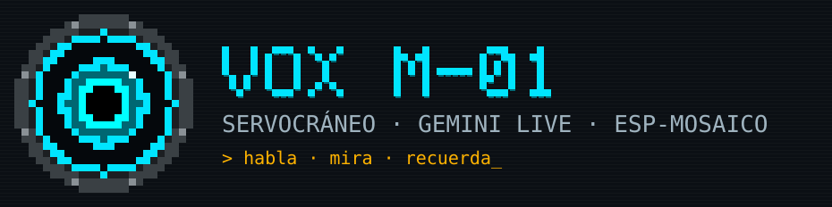
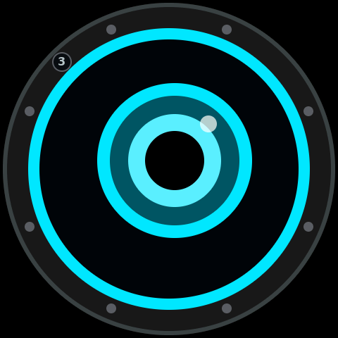
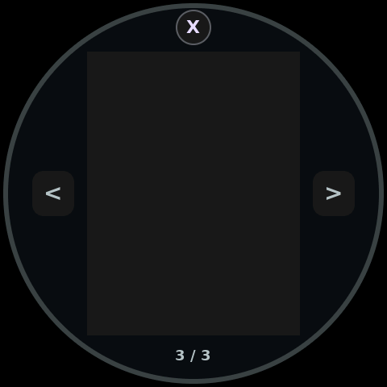
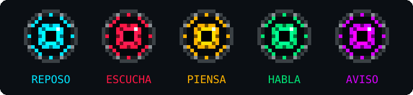

<p align="center">
  
</p>

<p align="center">
  <b>Un ojo mecánico que te escucha, te responde con voz, mira por su cámara y recuerda lo que ha visto.</b><br>
  Todo dentro de un ESP-Mosaico (ESP32-S31), sin ordenador, sin servidores intermedios y sin app en el móvil.
</p>

<p align="center">
  
  
  
  
  
</p>

---

## ✨ Qué es VOX M-01

VOX M-01 convierte la placa **ESP-Mosaico** en un **servocráneo conversacional**: la pantalla redonda
se transforma en un ojo mecánico a pantalla completa, y detrás hay **Gemini Live**, la IA de voz en
tiempo real de Google. Le dices **«Hola ESP»** y conversas con él como con una persona: le preguntas,
te contesta con voz natural, le interrumpes con un toque y, si le preguntas **«¿qué ves?»**, hace una
foto con su cámara y te la describe.

<p align="center">
  
  &nbsp;&nbsp;
  
</p>
<p align="center"><sub>El ojo en reposo (arriba a la izquierda, el número de fotos guardadas) y la galería. Capturas del simulador oficial, con la misma interfaz que el dispositivo.</sub></p>

### El ojo habla con colores

<p align="center">
  
</p>

| Color | Qué significa |
|---|---|
| 🔵 **Cian** | En reposo: espera «Hola ESP» o un toque |
| 🔴 **Rojo** | Te está escuchando |
| 🟠 **Ámbar** | Conectando, pensando o haciendo una foto («OBSERVANDO») |
| 🟢 **Verde** | Te está respondiendo (el iris late con su voz) |
| 🟣 **Violeta** | Aviso: falta Wi-Fi, falta la clave o hay un error (lo pone en pantalla) |

## 🚀 Lo que hemos conseguido

| | Ventaja | Por qué importa |
|---|---|---|
| 🗣️ | **Conversación de voz en tiempo real** | Gemini Live directo desde el chip por WebSocket seguro. Sin PC, sin nube propia, sin app: enchufar y hablar. |
| 👂 | **«Hola ESP» en local** | La palabra de activación se reconoce **dentro del dispositivo** (ESP-SR WakeNet). Hasta que la oye, no se envía ni un segundo de audio. |
| ✋ | **Interrumpible con un toque** | Si se enrolla, tocas la pantalla y calla al instante. Otro toque cierra la conversación. |
| 👁️ | **Visión bajo demanda** | Pregúntale «¿qué ves?»: hace la foto, la recorta, gira y comprime **por hardware** (JPEG de unos 15 KB en torno a un segundo) y Gemini la describe. |
| 🖼️ | **Galería de recuerdos** | Guarda las **10 últimas fotos** en su memoria flash, aunque lo apagues. Toca el contador para verlas, ‹ › para pasar, **X** para volver y **mantén la X 1,5 s** para borrarlas todas. |
| 🔒 | **Privacidad y seguridad** | Las fotos no salen del aparato (Gemini solo recibe la que te describe). La clave de Gemini **no está** en el código, el binario ni GitHub: se guarda en el propio dispositivo y no se puede leer desde fuera. |
| 🔁 | **Robusto** | Reconexión automática, modelo de reserva si el principal falla, avisos claros en pantalla y modo de recuperación siempre disponible. |
| 🎲 | **Modo rol (RoleMaster, 1.6.0)** | Di «vamos a jugar a rol» y VOX hace de **máster**: explica las reglas, crea los personajes, interpreta a cada uno con su propia voz y pide tiradas. Los dados son **reales** (generador aleatorio del chip) y salen animados en pantalla, con crítico y pifia. Sirve para tres tipos de juego: dados que se **suman** (2d20, 3d6), **porcentaje** (d100 con dos d10) y **reserva** (hasta 10 dados contando éxitos). |
| 🤫 | **Secretos en el móvil** | En modo rol, cada jugador abre en su móvil la dirección que sale en pantalla, escribe su nombre y recibe **solo sus secretos**. Si alguien no tiene móvil, el suyo sale en pantalla hasta que la toca. |
| 🎙️ | **Cuatro voces** | Charon y Algenib (chico), Kore y Sulafat (chica). Se cambian pidiéndoselo («ponte voz de chica»), tocando el círculo de arriba a la derecha o por USB. |
| 🔎 | **Google Search opcional** | Puede buscar en Google datos recientes (desactivado por defecto: el plan gratuito agota la cuota). |
| 💸 | **Coste cero para empezar** | Funciona con el **plan gratuito** de Gemini (con sus límites de uso). |
| 🧪 | **Hecho con rigor** | Tests en PC, simulador de la interfaz, parches documentados y probados en el hardware real, y una copia mínima del BSP oficial que arregla la memoria DMA de la pantalla. |

> [!NOTE]
> **Limitación conocida:** después de instalar un firmware (o de un reinicio por software), la cámara
> no hace fotos hasta que **apagas y enciendes con el botón de encendido**. El resto funciona igual.
> Está investigado y documentado en [docs/INSTALL.md](docs/INSTALL.md) (prueba 13).

---

## 🅰️ Guía A: tengo un ESP-Mosaico nuevo y quiero instalar VOX

Para quien tiene el ESP-Mosaico tal como viene de fábrica (con ESP-Claw) y actualizado.
No hace falta saber programar: solo copiar y pegar unas órdenes. Tiempo: unos 20 minutos.

### Lo que necesitas

- Un ordenador con **Windows 10/11** (en Mac o Linux los pasos son casi iguales).
- Un **cable USB-C de datos** (algunos cables solo cargan; si el PC no lo detecta, prueba otro).
- Una red **Wi-Fi** con Internet.
- Una **cuenta de Google** para crear tu clave gratuita de Gemini.
- Acceso a este repositorio en GitHub (si es privado, pide al propietario que te invite).

### Paso 1. Instala Python y Git (solo la primera vez)

1. Descarga **Python 3.10 o superior** desde <https://www.python.org/downloads/>. Al instalarlo,
   **marca la casilla «Add python.exe to PATH»**.
2. Descarga **Git** desde <https://git-scm.com/download/win> e instálalo con las opciones por defecto.
3. Abre **PowerShell** (botón Inicio → escribe «PowerShell» → Intro) y comprueba que ambos responden:

```powershell
python --version
```

```powershell
git --version
```

### Paso 2. Descarga las herramientas oficiales y este proyecto

Copia y pega estas órdenes en PowerShell, una a una. Crean la carpeta `esp-mosaico-vibe` en tu
carpeta de usuario.

```powershell
git clone https://github.com/esp-mosaico/esp-mosaico-vibe.git
```

```powershell
cd esp-mosaico-vibe
```

```powershell
git submodule update --init submodule/esp-mosaico-utils
```

```powershell
git clone https://github.com/surgatengit/cogitador_gemini.git projects/servocraneo_gemini_direct
```

### Paso 3. Descarga el firmware ya compilado

1. Entra en la página de **[Releases](https://github.com/surgatengit/cogitador_gemini/releases/latest)**
   de este repositorio.
2. Descarga el archivo **`vox-m01-v1.5.0.irisfw`**.
3. Guárdalo dentro de la carpeta `esp-mosaico-vibe\projects\servocraneo_gemini_direct`.

> [!TIP]
> No necesitas instalar ESP-IDF ni compilar nada: el archivo `.irisfw` ya trae todo (aplicación, ojo y
> modelo de «Hola ESP»).

### Paso 4. Antes de instalar: apunta cómo volver

En la pantalla del ESP-Mosaico, entra en **Mis Ideas** y comprueba que aparece **ESP-Claw**
(código **100000**). Lo necesitarás si algún día quieres volver a dejarlo de fábrica (Guía B).

### Paso 5. Instala VOX

1. Conecta el ESP-Mosaico al ordenador con el cable USB-C y enciéndelo.
2. En PowerShell, dentro de `esp-mosaico-vibe`, ejecuta:

```powershell
python mosaico.py iris system-update --bundle projects/servocraneo_gemini_direct/vox-m01-v1.5.0.irisfw
```

3. La primera vez tardará un poco más (descarga sus herramientas). Espera a ver
   **`iris system-update: succeeded`**. No desconectes el cable mientras tanto.
4. **Apaga y enciende** el ESP-Mosaico con su botón de encendido. Así la cámara arranca bien.

> [!WARNING]
> No uses `python mosaico.py recover` ni `iris app-update`: no hacen falta en un equipo nuevo y
> `app-update` no funciona con este proyecto.

### Paso 6. Wi-Fi

VOX usa el Wi-Fi que ya tenga guardado el ESP-Mosaico (el mismo que usaba ESP-Claw). Si el ojo se
pone **violeta** con «SIN WI-FI», configura la red desde **Vibe Mode** en la pantalla del dispositivo
(mantén pulsado el botón **AI** mientras lo enciendes para entrar).

### Paso 7. Crea tu clave de Gemini y guárdala en el dispositivo

1. Entra en <https://aistudio.google.com/apikey> con tu cuenta de Google y pulsa **Create API key**.
   Copia la clave (empieza por `AIza…`). **No la compartas con nadie.**
2. Con el ESP-Mosaico conectado por USB, ejecuta:

```powershell
python projects/servocraneo_gemini_direct/tools/provision_key.py
```

3. Pega la clave cuando te la pida (no se verá al escribir) y pulsa Intro. Debe responder que la clave
   está guardada.

### Paso 8. ¡A hablar!

Di **«Hola ESP»** o toca la pantalla. El ojo se pone ámbar mientras conecta y rojo cuando te escucha.
Prueba con:

- «¿Quién eres?»
- «¿Qué ves?» (hace una foto con la cámara de la izquierda)
- Toca el número de arriba a la izquierda para ver la galería de fotos.
- «Vamos a jugar una partida de rol» (1.6.0): sigue las indicaciones del máster y abre en el móvil
  la dirección que aparece abajo en la pantalla.

---

## 🅱️ Guía B: quiero volver a dejarlo de fábrica (ESP-Claw)

Para quien tiene VOX instalado y quiere dejar el ESP-Mosaico como venía, con el último firmware
oficial. Tus Ideas descargadas, el Wi-Fi y Vibe Mode se conservan.

### Paso 1. Borra tu clave de Gemini del dispositivo

Con VOX en marcha y conectado por USB, en PowerShell dentro de `esp-mosaico-vibe`:

```powershell
python projects/servocraneo_gemini_direct/tools/provision_key.py --clear
```

Así tu clave no se queda guardada en el aparato.

### Paso 2. Entra en Vibe Mode

Apaga el ESP-Mosaico. **Mantén pulsado el botón AI** y, sin soltarlo, enciéndelo. Suelta el botón
cuando veas el menú de Vibe Mode.

### Paso 3. Elige ESP-Claw

1. En la pantalla: **Mis Ideas → ESP-Claw → seleccionar como aplicación de arranque**.
2. Si ESP-Claw no aparece: **Descargar Ideas** e introduce el código **100000** (necesita Wi-Fi).
   Así se descarga la última versión oficial.
3. Vibe Mode comprueba el paquete, lo instala y reinicia. Cuando arranque ESP-Claw, ya está como de
   fábrica.

### Paso 4 (recomendado). Revoca la clave

Entra en <https://aistudio.google.com/apikey> y borra la clave que creaste para VOX. Es lo más seguro
si el dispositivo va a cambiar de manos.

> [!IMPORTANT]
> **Solo si el dispositivo no arranca ni en ESP-Claw ni en Vibe Mode**, existe un último recurso:
> `python mosaico.py recover`. Léete antes la sección 3 de [docs/INSTALL.md](docs/INSTALL.md).

---

## 🧭 Documentación

| Documento | Contenido |
|---|---|
| [docs/HANDOFF.md](docs/HANDOFF.md) | Estado actual del proyecto y cómo retomarlo |
| [docs/INSTALL.md](docs/INSTALL.md) | Instalación, restauración, auditoría de seguridad y todas las pruebas físicas |
| [docs/DESIGN.md](docs/DESIGN.md) | Diseño, requisitos y decisiones |
| [docs/GOOGLE_SEARCH.md](docs/GOOGLE_SEARCH.md) | Google Search: fuentes, cuotas, costes y pensamiento |
| [docs/RESEARCH.md](docs/RESEARCH.md) | Proyectos de referencia y propuesta por fases |
| [docs/ROADMAP.md](docs/ROADMAP.md) | Ampliaciones futuras (Extended Thinking, base magnética…) |

## 🛠️ Para desarrolladores

### Componentes

| Componente | Responsabilidad |
|---|---|
| [`app_vox_eye`](components/app_vox_eye/README.md) | Ojo mecánico GSP (iris, parpadeo, colores, toque, galería, hasta 10 dados, secretos, botones de voz y de dados); también corre en el simulador |
| [`app_vox_session`](components/app_vox_session/README.md) | Máquina de estados de la conversación; herramientas `capturar_imagen`, `tirar_dados`, `preparar_tirada`, `cambiar_voz`, `modo_rol` y `mostrar_secreto`; galería |
| [`app_gemini_live`](components/app_gemini_live/README.md) | Cliente Gemini Live por WSS (setup, audio, imágenes, herramientas, reanudación, grounding) |
| [`app_camera`](components/app_camera/README.md) | Fotos bajo demanda: cámara izquierda, reset del sensor, PPA y JPEG por hardware |
| [`app_photos`](components/app_photos/README.md) | Últimas 10 fotos en la partición `photos` |
| [`app_rol_web`](components/app_rol_web/README.md) | Página del móvil para los secretos del modo rol (solo mientras dura) |
| [`app_audio`](components/app_audio/README.md) | ES8311: captura 48k→16k y reproducción 24k→48k |
| [`app_wake`](components/app_wake/README.md) | «Hola ESP» local (ESP-SR WakeNet10 `wn10_es_holaesp`), solo en reposo |
| [`app_wifi`](components/app_wifi/README.md) | Estación Wi-Fi con las credenciales de Vibe Mode |
| [`app_secrets`](components/app_secrets/README.md) | Clave de API en NVS propio + RPC privada de provisión |
| [`app_config`](components/app_config/README.md), [`app_display`](components/app_display/README.md) | Plantilla: Wi-Fi compartido y pantalla CO5300 |

### Requisitos

Este repositorio va en `esp-mosaico-vibe/projects/servocraneo_gemini_direct/` (usa
`../../submodule/esp-mosaico-utils` y `../../submodule/esp-mosaico-bsp`), con ESP-IDF en el commit
`7b9cc1ac79f865983f59bb8ff3ff43eb74ff1dbe` para `esp32s31`.

Copias mínimas en `third_party/` (Apache-2.0), comprobadas con `python tools/check_bsp_fork.py`:
el BSP con un cambio para la memoria DMA de la pantalla (`VOX_FORK.md`) y `mosaico_module_camera`
con el arreglo oficial de PWDN `b60f5d8`. Los submódulos no se modifican.

### Compilar, simular e instalar (desde la raíz del espacio de trabajo)

```powershell
$env:IDF_CONFIGDEP_ENABLE = "0"   # la ruta del espacio de trabajo contiene espacios
python submodule/esp-mosaico-utils/mosaico-tools/skills/idf-low-noise-build/scripts/idf_low_noise_build.py --project projects/servocraneo_gemini_direct --idf-path C:\esp\esp-idf-master build
python mosaico.py project sim --project projects/servocraneo_gemini_direct --interactive
python mosaico.py iris system-update --project projects/servocraneo_gemini_direct
```

- Tests en PC: `tools/host_tests/run.ps1`.
- El bootloader no se compila: las aplicaciones usan el bootloader retenido de Vibe Mode.
- `app-update` no sirve en este dispositivo (`recovery_required`): usa siempre `system-update`.
- Nunca subas `.env`, claves, tokens, `sdkconfig` ni binarios (`.gitignore` los excluye). Los
  firmware compilados se publican solo como *Releases*.

---

<p align="center"><sub>Hecho con 🔧 y ☕ para ESP-Mosaico · Apache-2.0</sub></p>
